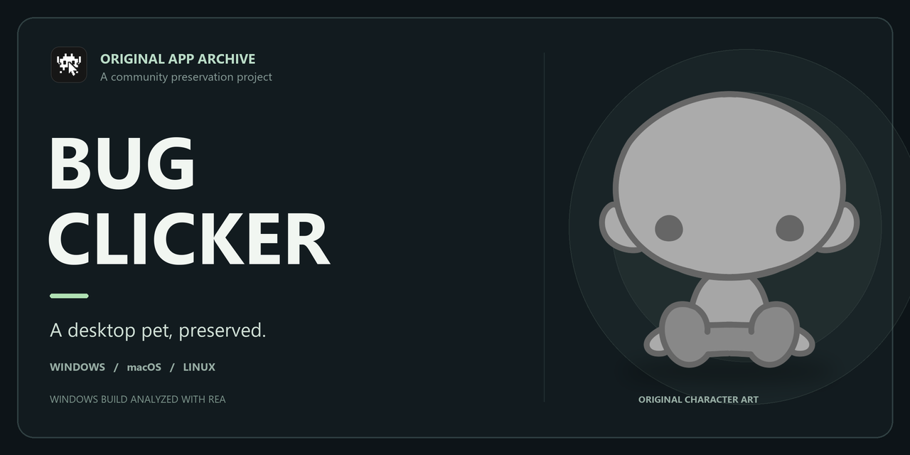

# BUG Clicker — 원본 앱 아카이브

[English](README.md) · **한국어**

[BUG / BUG-INVADE](https://github.com/BUG-INVADE)가 제작한 데스크톱 펫 앱 **BUG Clicker**의 독립 아카이브입니다. Windows·macOS·Linux 배포본에서 추출한 앱 파일과 캐릭터 에셋을 보존합니다. 원 제작자의 개발 저장소나 공식 배포본은 아닙니다.

## 수록 버전

| 폴더 | 원본 앱 버전 | 원본 설치 파일 아키텍처 |
| --- | --- | --- |
| [`windows/`](windows/) | 1.19.2 | x64 |
| [`mac/`](mac/) | 1.4.2 | Intel x64 및 Apple Silicon arm64 |
| [`linux/`](linux/) | 1.0.0 | x64 |

각 `extracted/`에는 배포된 앱 코드와 에셋이, `resources/`에는 원본 ASAR과 플랫폼별 보조 파일이 있습니다. 세 앱 버전은 서로 다릅니다. **Electron은 포함되어 있지 않으며**, 원본 세 배포본은 모두 Electron **44.2.0**을 사용했습니다.

## 실행 방법

Electron 설치, Linux 라이브러리·자동 실행 및 OS별 실행 절차는 **[한국어 설치 안내](docs/install-ko.md)**를 참조하세요. [English installation guide](docs/install.md)도 제공합니다.

Windows와 Linux WSL 환경에서 격리된 프로필로 실행을 확인했습니다. 실제 macOS와 Linux ARM64 실행은 아직 검증하지 못했습니다. 개발용 Electron 실행은 설치본의 서명, 업데이트, 경로 및 OS 통합과 다를 수 있습니다.

## 추출과 분석

앱 패키지는 원본 설치 파일에서 추출했으며 JavaScript는 배포용으로 압축되어 있습니다. Windows에서는 `tar`로 설치 파일에서 `app.asar`를 꺼내고 별도 ASAR 헤더 파서로 내용을 풀었습니다. 이후 Windows 버전을 [REA 6.8.0](https://rea.tools/)([소스](https://github.com/morluto/rea))으로 정적 분석했습니다. ASAR 추출에 REA를 사용한 것은 아니며, 정적 분석만으로 모든 동작을 보장하지 않습니다.

패키지 해시와 파일 수, 분석 범위는 [추출·검증 기록](docs/archive-method.md)에서 확인할 수 있습니다(영문).

원본 업데이트·안내 주소는 그대로 보존되어 있습니다. 실행 중 원 제작자의 서버에 접근하거나 기존 로컬 사용자 데이터를 사용할 수 있으므로 실행 전 설치 안내를 확인하세요.

## 출처와 라이선스

BUG Clicker와 포함된 에셋의 권리는 각 제작자에게 있습니다. 앱 메타데이터에는 저자가 BUG, 라이선스가 MIT로 표시되어 있지만, 이 표기만으로 모든 에셋의 재배포 조건이 확인된 것은 아닙니다. 포함된 고지를 유지하고 구성물별 권리를 확인해 주세요.
