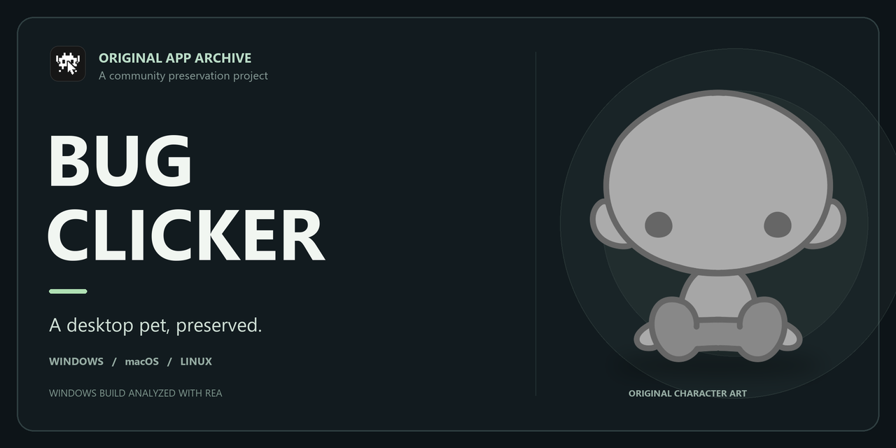

# BUG Clicker — Original App Archive

**English** · [한국어](README-KO.md)

An independent archive of the original **BUG Clicker** desktop pet app by [BUG / BUG-INVADE](https://github.com/BUG-INVADE). It contains the application files and character assets extracted from the Windows, macOS, and Linux releases. This is not the original development repository or an official release.

## Releases in this archive

| Folder | Original app version | Original installer architecture |
| --- | --- | --- |
| [`windows/`](windows/) | 1.19.2 | x64 |
| [`mac/`](mac/) | 1.4.2 | Intel x64 and Apple Silicon arm64 |
| [`linux/`](linux/) | 1.0.0 | x64 |

Each `extracted/` directory contains the packaged app code and assets; `resources/` preserves the original ASAR and platform-specific files. The three versions differ. **Electron itself is not included**; all three original releases used Electron **44.2.0**.

## Run the app

See the **[installation and launch guide](docs/install.md)** for Electron setup, Linux dependencies and autostart, and platform-specific instructions. [한국어 설치 안내](docs/install-ko.md) is also available.

Windows and a Linux WSL environment have been tested with isolated profiles. Actual macOS execution and Linux ARM64 are not yet verified. Running from a development Electron build can differ from the signed or packaged installer, including updates, paths, and OS integration.

## Extraction and analysis

The app packages were extracted from the original installers; the JavaScript is distributed in packaged, minified form. For Windows, `tar` extracted `app.asar` from the installer and a custom ASAR-header parser unpacked its contents. The Windows build was subsequently examined with [REA 6.8.0](https://rea.tools/) ([source](https://github.com/morluto/rea)) for static analysis. REA was not the extraction tool, and static analysis does not establish complete behavior.

See the [archive method and verification](docs/archive-method.md) for package hashes, file counts, and the scope of analysis.

Original update and help URLs are retained. Running the app may access the original developer's services or use existing local user data; see the installation guide before launching.

## Attribution and licenses

BUG Clicker and its included assets belong to their respective creators. The bundled app metadata identifies BUG as author and states MIT, but that label alone does not establish redistribution terms for every asset. Preserve included notices and verify the rights applicable to each component before redistributing it.
